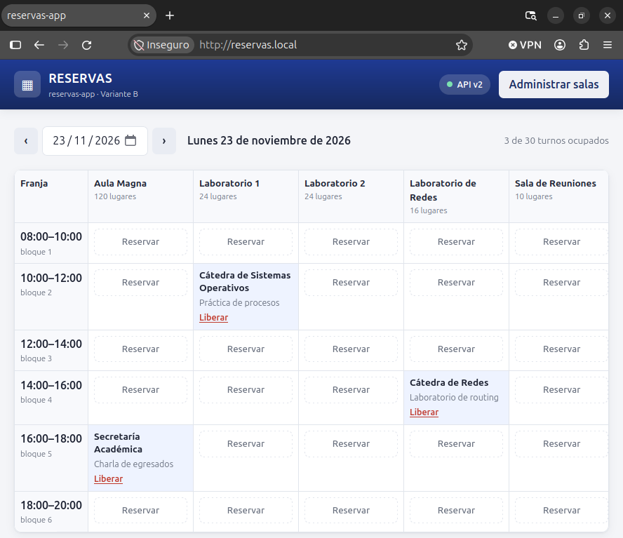

# Informe de funcionamiento — Proyecto integrador

**Proyecto:** reservas-app
**Variante:** B — Sistema de reservas de salas
**Curso:** Contenedores, Docker y Orquestación con Kubernetes
**Institución:** FACET — Universidad Nacional de Tucumán
**Fecha:** 23 de noviembre de 2026

---

## 1. Introducción

El presente informe reúne las evidencias obtenidas durante la implementación y verificación de `reservas-app`, una aplicación de reserva de salas y laboratorios por fecha y franja horaria.

La solución está compuesta por:

- Un frontend desarrollado con React y Vite, servido mediante Nginx.
- Una API REST implementada con Node.js 20 y Express.
- Una base de datos MySQL 8.4.

Durante el curso se utilizaron Docker y Docker Compose para construir y ejecutar los contenedores. Posteriormente se trasladó el despliegue a Kubernetes, donde se incorporaron Services, Deployments, ConfigMaps, Secret, almacenamiento persistente, Ingress y escalado automático.

Finalmente, los doce objetos principales se consolidaron en un chart de Helm.

El objetivo de este informe es demostrar, mediante resultados verificables, que la aplicación:

1. Responde correctamente a través del Ingress.
2. Conserva las reservas en MySQL.
3. Escala automáticamente su API bajo carga.
4. Permite modificar la configuración mediante Helm.
5. Puede actualizarse y revertirse sin perder información.
6. Evita reservas duplicadas durante solicitudes concurrentes.

Las decisiones arquitectónicas que fundamentan estos comportamientos se desarrollan en `ARQUITECTURA.md`.

---

## 2. Evidencia 1 — Aplicación accesible mediante Ingress

### 2.1. Configuración del acceso

Se configuró el objeto `reservas-app-ingress` con las siguientes características:

| Propiedad | Valor |
|---|---|
| IngressClass | nginx |
| Host | reservas.local |
| Ruta | / |
| Service de destino | reservas-frontend |
| Puerto de destino | 8080 |
| Dirección del Ingress Controller | 172.16.20.221 |

El frontend utiliza Nginx para servir los archivos de React y reenviar las solicitudes `/api` al Service interno `reservas-api`, en el puerto 3000.

De esta manera, el navegador accede a la aplicación y a la API utilizando el mismo origen.

### 2.2. Verificación del Ingress

Se utilizó el siguiente comando:

```bash
kubectl get ingress -n reservas-app
```

La salida confirmó que `reservas-app-ingress` utilizaba el host `reservas.local`, la clase `nginx` y la dirección `172.16.20.221`.

Posteriormente se comprobó la conectividad con la API:

```bash
curl -fsS http://reservas.local/api/health \
  | python3 -m json.tool
```

Resultado registrado después del rollback:

```json
{
  "status": "ok",
  "db": "ok",
  "version": "v1"
}
```

Este resultado confirma tres condiciones:

- El Ingress permite acceder al frontend.
- El proxy de Nginx alcanza correctamente la API.
- La API mantiene una conexión funcional con MySQL.

Durante el TP7 también se verificaron las siguientes rutas:

```text
GET /reservas
HTTP 200 — text/html

GET /api/reservas
HTTP 200 — application/json
```

La diferencia entre ambos tipos de contenido permitió comprobar que la ruta `/api/reservas` llegaba efectivamente a Express.

Una respuesta HTTP 200 con contenido HTML, por sí sola, no habría sido suficiente para demostrar el acceso a la API, debido al mecanismo de fallback utilizado por la aplicación React.

### 2.3. Creación de una reserva desde el navegador

Durante el TP7 se creó una reserva mediante la interfaz web.

Los datos registrados fueron:

| Campo | Valor |
|---|---|
| ID | 7 |
| Sala | Laboratorio 1 |
| Fecha | 2026-12-01 |
| Franja | 5 |
| Responsable | Prueba PVC TP7 |
| Motivo | Verificar persistencia en Kubernetes |

La reserva fue verificada mediante una consulta SQL.

Posteriormente se eliminó el Pod de MySQL y se permitió que Kubernetes creara automáticamente uno nuevo.

Una segunda consulta confirmó que la reserva con ID 7 conservaba sus datos.

Esta prueba permitió demostrar que el almacenamiento persistente funcionaba correctamente y que la información no dependía del ciclo de vida del Pod.

Los pasos y resultados de esta experiencia se encuentran documentados en el `README.md`, dentro de la sección «Prueba de persistencia» correspondiente al TP7.

### 2.4. Interpretación

El funcionamiento del Ingress y la persistencia de la reserva permiten validar el recorrido completo:

```text
Navegador
   |
   v
Ingress: reservas.local
   |
   v
Service: reservas-frontend:8080
   |
   v
Nginx: /api
   |
   v
Service: reservas-api:3000
   |
   v
MySQL: reservas-db:3306
```

La aplicación no depende de que el navegador acceda directamente a la API ni a MySQL.

---

## 3. Evidencia 2 — Escalado automático mediante HPA

### 3.1. Configuración del autoescalador

En la octava entrega se incorporó el objeto `reservas-api-hpa`.

Sus parámetros fueron:

| Parámetro | Valor |
|---|---|
| Deployment objetivo | reservas-api |
| API del recurso | autoscaling/v2 |
| Réplicas mínimas | 2 |
| Réplicas máximas | 6 |
| Métrica | CPU |
| Utilización objetivo | 50 % |
| CPU solicitada por contenedor | 100m |

Para permitir el cálculo del porcentaje, el Deployment de la API incorporó solicitudes y límites de recursos:

```yaml
resources:
  requests:
    cpu: 100m
    memory: 64Mi
  limits:
    cpu: 250m
    memory: 128Mi
```

El valor de utilización del HPA se calcula respecto del request de CPU.

Por lo tanto, un objetivo del 50 % sobre 100m representa aproximadamente 50 millicores de utilización promedio por réplica.

La disponibilidad de métricas se comprobó mediante metrics-server.

### 3.2. Generación de carga

La prueba se efectuó desde el propio clúster mediante tres Pods temporales basados en BusyBox.

Los generadores realizaron solicitudes HTTP reiteradas al endpoint:

```text
http://reservas-api:3000/reservas
```

Este endpoint consulta las reservas almacenadas en MySQL y recupera información relacionada con las salas.

La utilización de varios generadores simultáneos permitió producir una carga suficiente para activar el escalado horizontal.

El comportamiento del HPA se observó mediante:

```bash
kubectl get hpa reservas-api-hpa \
  -n reservas-app -w
```

También se verificó la cantidad de réplicas disponibles en el Deployment de la API.

### 3.3. Resultados observados

La prueba comenzó con dos réplicas de `reservas-api`.

Al aumentar la cantidad de solicitudes, el consumo de CPU superó el objetivo establecido.

Durante la observación se registraron valores de utilización superiores al 100 %, incluyendo mediciones del 182 % y del 226 % respecto del request.

Como respuesta, el HPA incrementó progresivamente la cantidad de réplicas:

```text
Estado inicial:
2 réplicas

Durante la carga:
2 → 4 → 6 réplicas

Después de detener la carga:
6 → 2 réplicas
```

Al finalizar la generación de solicitudes, el consumo de CPU disminuyó.

Después de transcurrir el período de estabilización, Kubernetes redujo automáticamente el número de réplicas hasta alcanzar nuevamente el mínimo configurado.

### 3.4. Evidencia registrada

El seguimiento completo del HPA quedó almacenado en el siguiente archivo:

**[Registro de la prueba de carga — hpa-carga.log](informe/hpa-carga.log)**

El registro contiene las observaciones realizadas durante la generación de carga y el descenso posterior de las réplicas.

### 3.5. Interpretación

La prueba demuestra que el autoescalador no se limita a existir como recurso declarativo: modifica efectivamente la cantidad de Pods del Deployment.

También se comprobó la importancia de esperar la ventana de estabilización antes de evaluar el escalado descendente.

El comportamiento observado es coherente con la configuración del HPA y con la utilización de CPU de la API.

---

## 4. Evidencia 3 — Instalación, actualización y rollback con Helm

### 4.1. Validación del chart

Se construyó el chart `reservas-app`, compuesto por:

- `Chart.yaml`.
- `values.yaml`.
- Doce plantillas en `templates/`.

Las plantillas generan los siguientes recursos:

| Recurso | Cantidad |
|---|---:|
| Deployment | 3 |
| Service | 3 |
| ConfigMap | 2 |
| Secret | 1 |
| PersistentVolumeClaim | 1 |
| Ingress | 1 |
| HorizontalPodAutoscaler | 1 |
| **Total** | **12** |

Se comprobó el número de objetos renderizados:

```bash
helm template reservas-app ./reservas-app \
  -n reservas-app \
  | grep -c '^kind:'
```

Resultado:

```text
12
```

También se ejecutó:

```bash
helm lint ./reservas-app
```

El resultado indicó que el chart era válido:

```text
1 chart(s) linted, 0 chart(s) failed
```

La recomendación informativa sobre agregar un icono en `Chart.yaml` no representó un error de validación.

### 4.2. Instalación de la release

Los objetos de Kubernetes ya existían antes de incorporar Helm.

Por este motivo, se utilizó la opción `--take-ownership`, que permite adoptar recursos existentes.

Antes de la instalación se verificó el estado de los Deployments, el PVC y el Secret.

También se realizó un respaldo lógico de la base de datos y se preparó un archivo privado con las credenciales existentes.

El archivo de credenciales se mantuvo fuera del repositorio.

La instalación se ejecutó mediante:

```bash
helm install reservas-app ./reservas-app \
  --namespace reservas-app \
  --create-namespace \
  --take-ownership \
  --wait \
  --timeout 5m \
  -f "$HOME/reservas-app-backups/values-privados.json"
```

Resultado:

```text
NAME: reservas-app
NAMESPACE: reservas-app
STATUS: deployed
REVISION: 1
```

La salida completa quedó registrada en:

**[Instalación de Helm — helm-instalacion.log](informe/helm-instalacion.log)**

Después de la instalación se verificó que:

- La API estaba disponible con 2/2 réplicas.
- El frontend estaba disponible con 2/2 réplicas.
- MySQL estaba disponible con 1/1 réplica.
- El PVC permanecía en estado Bound.
- El HPA conservaba su configuración.
- MySQL mantenía las cuatro reservas anteriores.

Además, se comprobó que la release administraba los doce objetos:

```bash
helm get manifest reservas-app -n reservas-app \
  | grep -c '^kind:'
```

Resultado:

```text
12
```

### 4.3. Construcción y publicación de la API v2

La API se construyó utilizando el argumento `APP_VERSION`.

Se creó una imagen nueva mediante:

```bash
docker build \
  --build-arg APP_VERSION=v2 \
  -t laureanoa/reservas-api:v2 \
  ./backend
```

La versión se comprobó dentro de un contenedor temporal:

```bash
docker run --rm \
  --entrypoint sh \
  laureanoa/reservas-api:v2 \
  -c 'echo "APP_VERSION=$APP_VERSION"'
```

Resultado:

```text
APP_VERSION=v2
```

Después se publicó la imagen:

```bash
docker push laureanoa/reservas-api:v2
```

La publicación finalizó correctamente y el registro remoto quedó disponible para los nodos de Kubernetes.

### 4.4. Actualización de la release

La actualización se realizó modificando únicamente el tag de la imagen de la API.

Comando utilizado:

```bash
helm upgrade reservas-app ./reservas-app \
  --namespace reservas-app \
  --reuse-values \
  --set api.image.tag=v2 \
  --wait \
  --timeout 5m
```

La opción `--reuse-values` permitió conservar la configuración efectiva de la release anterior, incluidas las credenciales existentes de MySQL.

Helm informó:

```text
STATUS: deployed
REVISION: 2
```

**[Registro de actualización — helm-upgrade.log](informe/helm-upgrade.log)**

El Deployment de la API completó correctamente la actualización.

Posteriormente se verificó la versión mediante:

```bash
curl -fsS http://reservas.local/api/health \
  | python3 -m json.tool
```

Resultado:

```json
{
  "status": "ok",
  "db": "ok",
  "version": "v2"
}
```

Esto demuestra que el cambio de tag produjo una modificación real de la aplicación ejecutada en Kubernetes.

### 4.5. Evidencia visual de la versión v2

Durante la actualización se guardó una captura del navegador.



**Figura 1.** Captura de la aplicación durante la revisión 2 de Helm, con la API actualizada a v2.

El frontend mantuvo su imagen `v1`, mientras que la API pasó a ejecutar `v2`.

Esta diferencia confirma que ambas imágenes tienen ciclos de vida independientes y pueden actualizarse sin reconstruir conjuntamente los dos componentes.

### 4.6. Reversión a la versión anterior

Después de comprobar la versión v2, se ejecutó:

```bash
helm rollback reservas-app 1 \
  --namespace reservas-app \
  --wait \
  --timeout 5m
```

Resultado:

```text
Rollback was a success! Happy Helming!
```

**[Registro de reversión — helm-rollback.log](informe/helm-rollback.log)**

A continuación, se verificó que el Deployment había completado la actualización:

```bash
kubectl rollout status deployment/reservas-api \
  -n reservas-app --timeout=180s
```

Resultado:

```text
deployment "reservas-api" successfully rolled out
```

La consulta posterior al endpoint `/api/health` devolvió:

```json
{
  "status": "ok",
  "db": "ok",
  "version": "v1"
}
```

Por lo tanto, la reversión restauró correctamente la versión anterior de la API.

### 4.7. Historial final de Helm

Se consultó el historial de la release:

```bash
helm history reservas-app -n reservas-app
```

Resultado registrado:

```text
REVISION  STATUS      DESCRIPTION
1         superseded  Install complete
2         superseded  Upgrade complete
3         deployed    Rollback to 1
```

**[Historial completo — helm-historial.log](informe/helm-historial.log)**

El rollback no eliminó las revisiones anteriores, sino que generó una tercera revisión basada en la configuración de la revisión 1.

La release finalizó en estado `deployed`, con la API ejecutando nuevamente `v1`.

La columna `APP VERSION` del historial permaneció en `v1` porque corresponde al campo `appVersion` del chart, y no al tag efectivo de la imagen desplegada.

### 4.8. Interpretación

El ciclo completo permitió demostrar:

1. La instalación inicial de una release.
2. La actualización controlada de una imagen.
3. La creación de una nueva revisión.
4. La recuperación de una configuración anterior.
5. La conservación de los datos persistentes.
6. La independencia entre las imágenes del frontend y la API.

El ciclo `install → upgrade → rollback` quedó registrado mediante los logs de Helm y las comprobaciones HTTP de la aplicación.

---

## 5. Evidencia 4 — Parametrización efectiva del chart

### 5.1. Objetivo de la prueba

Un archivo `values.yaml` no constituye una parametrización real si las plantillas no utilizan sus valores.

Por ese motivo, durante el TP8 se renderizaron las mismas plantillas utilizando configuraciones diferentes.

La prueba permitió comprobar que las modificaciones de los valores producían cambios visibles en los manifiestos generados.

### 5.2. Ejemplo: NodePort del frontend

Se renderizó inicialmente el Service del frontend:

```bash
helm template reservas-app ./reservas-app \
  -n reservas-app \
  --show-only templates/svc-reservas-frontend.yaml
```

Con los valores predeterminados, se obtuvo:

```yaml
type: NodePort
ports:
  - port: 8080
    nodePort: 30301
```

Posteriormente se ejecutó:

```bash
helm template reservas-app ./reservas-app \
  -n reservas-app \
  --show-only templates/svc-reservas-frontend.yaml \
  --set frontend.service.nodePort=30302
```

El nuevo manifiesto mostró:

```yaml
type: NodePort
ports:
  - port: 8080
    nodePort: 30302
```

La modificación de `frontend.service.nodePort` produjo un cambio real en el Service generado.

### 5.3. Ejemplo: parámetros del HPA

También se comprobó la parametrización del autoescalador.

Primero se renderizó su configuración predeterminada:

```bash
helm template reservas-app ./reservas-app \
  -n reservas-app \
  --show-only templates/hpa-reservas-api.yaml
```

El resultado incluyó:

```yaml
minReplicas: 2
maxReplicas: 6
averageUtilization: 50
```

Después se modificaron dos parámetros:

```bash
helm template reservas-app ./reservas-app \
  -n reservas-app \
  --show-only templates/hpa-reservas-api.yaml \
  --set hpa.maxReplicas=4 \
  --set hpa.targetCPUUtilizationPercentage=60
```

El manifiesto generado cambió a:

```yaml
minReplicas: 2
maxReplicas: 4
averageUtilization: 60
```

Esta segunda prueba demuestra que también se encuentran parametrizados el límite máximo de réplicas y el objetivo de utilización de CPU.

### 5.4. Interpretación

Ambos ensayos se realizaron mediante `helm template`, sin modificar los recursos instalados en el clúster.

Se comprobó que las plantillas utilizan efectivamente los valores proporcionados.

La parametrización también se verificó para otros elementos del chart, entre ellos los tags de las imágenes, la cantidad de réplicas, la configuración de los ConfigMaps, el host del Ingress y el tamaño solicitado del almacenamiento.

El `helm upgrade` de la API de v1 a v2 constituyó, además, una prueba de parametrización aplicada sobre la release real.

---

## 6. Evidencia 5 — Integridad de reservas con tres réplicas

### 6.1. Objetivo

La prueba de concurrencia se realizó durante el TP6 para comprobar que múltiples réplicas de la API no permitieran crear reservas duplicadas.

La condición de negocio establece que una sala no puede reservarse dos veces para una misma fecha y franja horaria.

### 6.2. Configuración de la prueba

Se escaló el Deployment de la API a tres réplicas.

Posteriormente se realizaron treinta solicitudes HTTP POST en paralelo sobre la misma combinación:

| Campo | Valor |
|---|---|
| Sala | 1 |
| Fecha | 2026-12-01 |
| Franja | 5 |
| Responsables | R1 a R30 |
| Solicitudes concurrentes | 30 |

La prueba utilizó responsables diferentes para que cada solicitud representara un intento independiente de reservar la misma combinación de sala, fecha y franja.

### 6.3. Resultados observados

El registro de la sexta entrega documentó la siguiente distribución:

```text
1 201
29 409
```

Interpretación de los códigos HTTP:

- `201 Created`: se creó correctamente una reserva.
- `409 Conflict`: se rechazó el intento de reservar una combinación ya ocupada.

De las treinta solicitudes concurrentes, solamente una consiguió crear la reserva.

Las otras veintinueve fueron rechazadas.

### 6.4. Validación mediante MySQL

La comprobación posterior se realizó mediante una consulta SQL que contó las reservas para la combinación utilizada.

La consulta equivalente es:

```sql
SELECT COUNT(*)
FROM reservas
WHERE sala_id = 1
  AND fecha = '2026-12-01'
  AND franja = 5;
```

El resultado documentado durante el TP6 fue:

```text
1
```

La restricción que permite garantizar este comportamiento se encuentra definida en `backend/db.js`:

```sql
CONSTRAINT sin_solapamiento
UNIQUE (sala_id, fecha, franja)
```

La aplicación también realiza un SELECT previo para detectar si la combinación está ocupada.

No obstante, esa consulta no proporciona por sí sola una garantía de integridad frente a solicitudes simultáneas.

La restricción UNIQUE es aplicada directamente por MySQL, incluso cuando diferentes réplicas procesan las solicitudes al mismo tiempo.

Cuando se intenta insertar una combinación duplicada, MySQL produce `ER_DUP_ENTRY`, que la API transforma en HTTP 409 Conflict.

### 6.5. Fuente de la evidencia

Los resultados originales de las treinta solicitudes y la consulta SQL se encuentran registrados en el `README.md`, sección:

**«Escalado y prueba de concurrencia» — TP6.**

Esa sección documenta:

- El escalado de dos a tres réplicas.
- La combinación de sala, fecha y franja utilizada.
- Las treinta solicitudes concurrentes.
- Los resultados HTTP 201 y 409.
- La consulta SQL que confirmó una única reserva.

La prueba no se repitió durante el TP8, ya que se conservó el resultado obtenido en la sexta entrega.

### 6.6. Interpretación

El ensayo permitió demostrar que la integridad de las reservas no depende del número de réplicas de la API.

La base de datos actúa como punto central de aplicación de la restricción de unicidad.

Por lo tanto, la arquitectura permite escalar horizontalmente la capa de aplicación sin perder la garantía de no duplicación de reservas para una misma combinación de sala, fecha y franja.

---

## 7. Verificación adicional — Persistencia durante la adopción por Helm

### 7.1. Estado anterior a la instalación

Antes de instalar Helm se comprobó el estado del PVC:

```bash
kubectl get pvc reservas-db-pvc -n reservas-app
```

Resultado relevante:

```text
NAME              STATUS   CAPACITY   ACCESS MODES   STORAGECLASS
reservas-db-pvc   Bound    1Gi        RWO            local-path
```

También se consultó el número de reservas almacenadas:

```bash
kubectl exec -n reservas-app deployment/reservas-db \
  -- sh -c '
    MYSQL_PWD="$MYSQL_PASSWORD" mysql \
      -u "$MYSQL_USER" "$MYSQL_DATABASE" \
      -N -e "SELECT COUNT(*) FROM reservas;"
  '
```

Resultado:

```text
4
```

### 7.2. Respaldo previo

Antes de adoptar los recursos existentes mediante Helm se generó un respaldo lógico utilizando `mysqldump`.

El archivo se guardó fuera del repositorio Git, con permisos restringidos.

El respaldo tenía un tamaño aproximado de 3,8 KiB y contenía las definiciones de las dos tablas de la aplicación:

- `salas`.
- `reservas`.

La creación del archivo se comprobó correctamente, aunque no se realizó una prueba de restauración completa.

### 7.3. Conservación del almacenamiento

La instalación de Helm se realizó utilizando `--take-ownership`, sin eliminar el PVC existente.

Después de la instalación, el volumen continuó en estado Bound y conservó el mismo identificador:

```text
pvc-16a86fa6-9230-4e75-84da-aef09b8b5ccf
```

La consulta posterior a MySQL devolvió nuevamente:

```text
4
```

Después de actualizar la API y efectuar el rollback, se repitió la consulta y el resultado continuó siendo cuatro reservas.

### 7.4. Interpretación

Esta verificación permitió demostrar que el cambio de administración hacia Helm y el ciclo de revisiones de la release no provocaron pérdida de los registros existentes.

La experiencia también mostró la importancia de realizar respaldos antes de ejecutar operaciones que puedan afectar recursos persistentes.

Debe distinguirse entre persistencia y backup: un PVC protege frente al reemplazo de un Pod, pero no sustituye una copia independiente de los datos.

---

## 8. Síntesis de resultados

| Prueba | Resultado |
|---|---|
| Acceso mediante Ingress | Correcto |
| Respuesta de `/api/health` | HTTP exitoso |
| Conectividad API–MySQL | Correcta |
| Persistencia de reserva del TP7 | Comprobada |
| HPA: escalado ascendente | 2 → 4 → 6 |
| HPA: escalado descendente | 6 → 2 |
| Objetos renderizados por Helm | 12 |
| Validación de Helm | Sin errores |
| Instalación de release | Revisión 1 |
| Actualización de API | v1 → v2 |
| Reversión de API | v2 → v1 |
| Historial de release | 3 revisiones |
| Reservas antes de Helm | 4 |
| Reservas después del rollback | 4 |
| Concurrencia del TP6 | 1 HTTP 201 y 29 HTTP 409 |
| Reservas duplicadas en la prueba | 0 |

---

## 9. Archivos de evidencia

Los registros generados durante el TP8 se encuentran en la carpeta `informe/`.

| Archivo | Contenido |
|---|---|
| [hpa-carga.log](informe/hpa-carga.log) | Comportamiento del HPA durante y después de la carga. |
| [helm-instalacion.log](informe/helm-instalacion.log) | Instalación inicial de la release. |
| [helm-upgrade.log](informe/helm-upgrade.log) | Actualización de la API a v2. |
| [helm-rollback.log](informe/helm-rollback.log) | Reversión a la revisión 1. |
| [helm-historial.log](informe/helm-historial.log) | Historial de tres revisiones. |
| [api-v2.png](informe/api-v2.png) | Captura del navegador durante la ejecución de API v2. |

El README conserva, además, los resultados y explicaciones de las pruebas realizadas durante las entregas anteriores.

---

## 10. Conclusión general

Las pruebas realizadas permiten acreditar el funcionamiento de `reservas-app` como aplicación de tres capas desplegada en Kubernetes.

Se verificó que el Ingress permite acceder a la API, que MySQL conserva las reservas mediante un PVC y que el HPA modifica dinámicamente la cantidad de réplicas según la utilización de CPU.

También se comprobó la parametrización efectiva del chart de Helm y se ejecutó exitosamente el ciclo de instalación, actualización y reversión.

La prueba de concurrencia de la sexta entrega demostró que la restricción de unicidad implementada en MySQL impide crear reservas duplicadas, incluso cuando la API ejecuta múltiples réplicas.

En conjunto, las evidencias documentan la integración de los contenidos desarrollados durante el curso y proporcionan una base verificable para evaluar las decisiones expuestas en `ARQUITECTURA.md`.

Las limitaciones de la solución y las mejoras necesarias para un entorno de producción se detallan en dicho documento.
