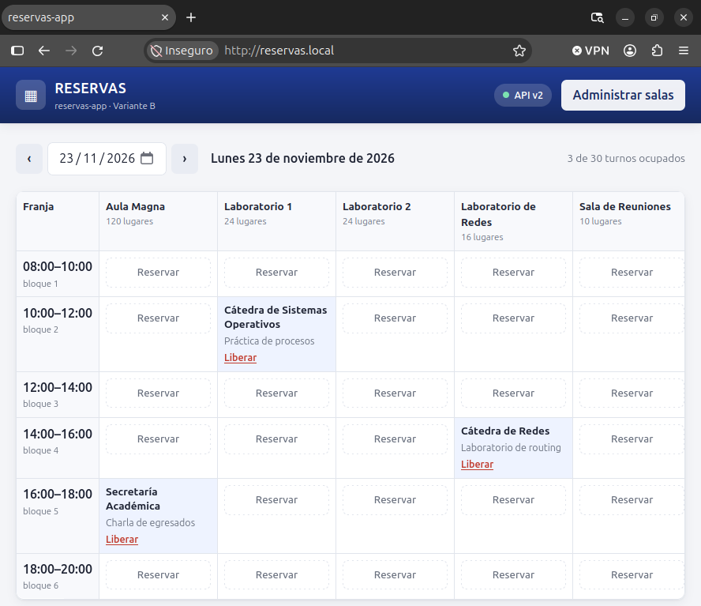

# reservas-app — Proyecto integrador

**Variante B: Sistema de reservas de salas y laboratorios**

**Curso:** Contenedores, Docker y Orquestación con Kubernetes
**Institución:** Facultad de Ciencias Exactas y Tecnología — Universidad Nacional de Tucumán (FACET-UNT)
**Fecha de entrega:** 23 de noviembre de 2026

---

## 1. Descripción del proyecto

`reservas-app` es una aplicación web que permite gestionar reservas de salas y laboratorios por fecha y franja horaria.

El sistema permite consultar las salas disponibles, registrar nuevas reservas, visualizar las reservas existentes y eliminar registros. La disponibilidad de cada sala se controla mediante una restricción de unicidad implementada directamente en MySQL.

El proyecto se desarrolló progresivamente durante las ocho semanas del curso, incorporando conceptos de construcción de imágenes, redes, volúmenes, seguridad, Docker Compose, Kubernetes, almacenamiento persistente, escalado horizontal y Helm.

La aplicación utiliza una arquitectura de tres capas:

- **Frontend:** React y Vite, servido mediante Nginx.
- **API REST:** Node.js 20 y Express.
- **Base de datos:** MySQL 8.4.

La implementación final se encuentra desplegada en Kubernetes y administrada mediante un chart Helm compuesto por doce objetos principales.

### 1.1. Características principales

- Gestión de salas y reservas mediante una interfaz web.
- API REST para operaciones de consulta, creación y eliminación.
- Prevención de reservas duplicadas mediante una restricción `UNIQUE` en MySQL.
- Construcción de imágenes optimizadas utilizando Dockerfiles multietapa.
- Ejecución local mediante Docker Compose.
- Configuración mediante variables de entorno.
- Comunicación interna mediante Services de Kubernetes.
- Persistencia de MySQL mediante PersistentVolumeClaim.
- Publicación de la aplicación mediante Ingress Nginx.
- Autoescalado de la API mediante HorizontalPodAutoscaler.
- Parametrización y gestión del despliegue mediante Helm.
- Actualización y reversión de versiones de la API.

### 1.2. Tecnologías utilizadas

| Componente | Tecnología | Puerto interno |
|---|---|---:|
| Frontend | React + Vite + Nginx | 8080 |
| API | Node.js 20 + Express | 3000 |
| Base de datos | MySQL 8.4 | 3306 |
| Contenedores | Docker | — |
| Orquestación local | Docker Compose | — |
| Orquestación | Kubernetes | — |
| Gestión de despliegues | Helm 3 | — |

---

## 2. Arquitectura de la aplicación

### 2.1. Arquitectura general

```text
                  Navegador
                      |
                      | HTTP
                      v
               reservas-frontend
                 React + Nginx
                    :8080
                      |
                      | Proxy /api
                      v
                 reservas-api
               Node.js + Express
                    :3000
                      |
                      | SQL
                      v
                 reservas-db
                   MySQL 8.4
                    :3306
```

El frontend constituye el punto de entrada de la aplicación.

Las solicitudes HTTP realizadas por React utilizan rutas relativas que comienzan con `/api`. Nginx recibe esas solicitudes y las reenvía internamente al backend.

La API procesa las operaciones y se comunica con MySQL mediante la red del entorno de ejecución.

El navegador no necesita acceder directamente a la base de datos ni conocer la dirección interna de la API.

### 2.2. Arquitectura en Kubernetes

En Kubernetes, el acceso se organiza de la siguiente manera:

```text
                   Navegador
                       |
                       v
             reservas.local
                       |
                       v
               Ingress Nginx
                       |
                       v
          Service reservas-frontend
                       |
                       v
          Deployment reservas-frontend
                  2 réplicas
                       |
                       | /api
                       v
             Service reservas-api
                       |
                       v
             Deployment reservas-api
                 2 a 6 réplicas
                       |
                       v
              Service reservas-db
                       |
                       v
              Deployment reservas-db
                   1 réplica
                       |
                       v
                 PVC de MySQL
                    1 GiB
```

El escalado horizontal se aplica únicamente a la API mediante el HPA `reservas-api-hpa`.

La base de datos conserva una única instancia y utiliza almacenamiento persistente.

### 2.3. Distribución de responsabilidades

| Componente | Responsabilidad |
|---|---|
| `reservas-frontend` | Presentar la interfaz y realizar el proxy hacia la API. |
| `reservas-api` | Procesar solicitudes, validar operaciones y ejecutar consultas SQL. |
| `reservas-db` | Almacenar las salas y reservas, y garantizar la integridad de los datos. |

Las decisiones arquitectónicas se fundamentan con mayor detalle en [ARQUITECTURA.md](ARQUITECTURA.md).

---

## 3. Estructura del repositorio

La estructura principal del proyecto es:

```text
reservas-app/
├── backend/
│   ├── Dockerfile
│   ├── package.json
│   ├── package-lock.json
│   ├── server.js
│   └── db.js
│
├── frontend/
│   ├── Dockerfile
│   ├── package.json
│   ├── package-lock.json
│   ├── nginx/
│   │   └── templates/
│   │       └── default.conf.template
│   └── src/
│
├── k8s/
│   ├── configmap-reservas-api.yaml
│   ├── configmap-reservas-frontend.yaml
│   ├── deploy-reservas-api.yaml
│   ├── deploy-reservas-db.yaml
│   ├── deploy-reservas-frontend.yaml
│   ├── hpa-reservas-api.yaml
│   ├── ingress-reservas-app.yaml
│   ├── pvc-reservas-db.yaml
│   ├── secret-reservas-db.yaml
│   ├── svc-reservas-api.yaml
│   ├── svc-reservas-db.yaml
│   └── svc-reservas-frontend.yaml
│
├── reservas-app/
│   ├── Chart.yaml
│   ├── values.yaml
│   └── templates/
│       └── [12 plantillas Helm]
│
├── informe/
│   ├── api-v2.png
│   ├── helm-historial.log
│   ├── helm-instalacion.log
│   ├── helm-rollback.log
│   ├── helm-upgrade.log
│   └── hpa-carga.log
│
├── .env.example
├── .gitignore
├── docker-compose.yml
├── ARQUITECTURA.md
├── INFORME.md
└── README.md
```

La carpeta `k8s/` conserva además los manifiestos históricos de los Pods utilizados durante las primeras prácticas y un Service NodePort auxiliar de depuración.

La carpeta `reservas-app/` contiene el chart Helm. Su nombre coincide con el del proyecto, pero su función es exclusivamente administrar el despliegue en Kubernetes.

---

## 4. Instalación y ejecución

El proyecto puede ejecutarse mediante Docker Compose o desplegarse en Kubernetes utilizando Helm.

Los procedimientos se presentan por separado porque corresponden a entornos de ejecución diferentes.

### 4.1. Requisitos

**Para Docker Compose:**

- Docker Engine.
- Docker Compose Plugin.
- Puertos 3000 y 3001 disponibles en el equipo anfitrión.

**Para Kubernetes y Helm:**

- Un clúster Kubernetes funcional.
- `kubectl` configurado para acceder al clúster.
- Helm 3 compatible con el chart.
- Ingress Controller Nginx para utilizar el acceso mediante Ingress.
- metrics-server para el funcionamiento del HPA.
- Una StorageClass disponible para el almacenamiento persistente de MySQL.
- Acceso a Docker Hub para descargar las imágenes publicadas.

El chart fue probado en el clúster `lamarillo`, dentro del namespace `reservas-app`, utilizando Helm 3.22.

### 4.2. Opción A — Docker Compose

#### Paso 1. Configurar las variables de entorno

Desde la raíz del repositorio:

```bash
cp .env.example .env
```

El archivo `.env.example` incluye las variables necesarias para los tres componentes.

Se deben revisar y modificar las credenciales de ejemplo antes de utilizar la aplicación fuera de un entorno de laboratorio.

Es importante mantener la correspondencia entre:

- `MYSQL_DATABASE` y `DB_NAME`.
- `MYSQL_USER` y `DB_USER`.
- `MYSQL_PASSWORD` y `DB_PASSWORD`.

El archivo `.env` está excluido del control de versiones mediante `.gitignore`.

#### Paso 2. Construir e iniciar los servicios

```bash
docker compose up -d --build
```

Docker Compose construye las imágenes propias, crea la red y el volumen, e inicia los servicios definidos en `docker-compose.yml`.

La configuración utiliza healthchecks y dependencias condicionadas para establecer el siguiente orden lógico:

```text
reservas-db (healthy)
        |
        v
reservas-api (healthy)
        |
        v
reservas-frontend
```

#### Paso 3. Verificar el estado

```bash
docker compose ps
```

Se espera que los tres servicios se encuentren iniciados y saludables.

#### Paso 4. Acceder a la aplicación

La interfaz web se encuentra disponible en:

```text
http://localhost:3000
```

La API dispone de un puerto adicional para depuración:

```text
http://localhost:3001/health
```

Para comprobar su funcionamiento:

```bash
curl -fsS http://localhost:3001/health
```

La respuesta esperada, con la versión predeterminada, es:

```json
{
  "status": "ok",
  "db": "ok",
  "version": "v1"
}
```

#### Paso 5. Detener los servicios

Para detener los contenedores conservando el volumen de MySQL:

```bash
docker compose down
```

**Advertencia:** el comando `docker compose down -v` elimina también el volumen asociado a la base de datos y puede ocasionar pérdida de información.

### 4.3. Opción B — Kubernetes mediante Helm

#### Paso 1. Verificar las imágenes

El chart utiliza las siguientes imágenes publicadas:

```text
laureanoa/reservas-api:v1
laureanoa/reservas-frontend:v1
mysql:8.4
```

La imagen `laureanoa/reservas-api:v2` también se encuentra publicada y fue utilizada para demostrar el proceso de actualización.

#### Paso 2. Validar el chart

Desde la raíz del repositorio:

```bash
helm lint ./reservas-app
```

Para renderizar los manifiestos:

```bash
helm template reservas-app ./reservas-app \
  --namespace reservas-app
```

Para contar los objetos generados:

```bash
helm template reservas-app ./reservas-app \
  --namespace reservas-app \
  | grep -c '^kind:'
```

El resultado esperado es:

```text
12
```

#### Paso 3. Configurar las credenciales

El archivo `reservas-app/values.yaml` contiene credenciales ficticias de laboratorio.

Estos valores permiten inspeccionar el chart y realizar pruebas en un entorno descartable.

Para utilizar credenciales propias, se recomienda crear un archivo de valores fuera del repositorio con la siguiente estructura:

```yaml
db:
  auth:
    user: "REEMPLAZAR_USUARIO"
    password: "REEMPLAZAR_PASSWORD"
    rootPassword: "REEMPLAZAR_ROOT_PASSWORD"
```

Las cadenas indicadas deben reemplazarse por los valores elegidos para el entorno.

Se recomienda restringir los permisos del archivo:

```bash
chmod 600 /ruta/privada/values-privados.yaml
```

El archivo privado no debe incorporarse al repositorio.

**Importante:** las variables de Docker Compose y los valores de Helm corresponden a entornos independientes. No es necesario utilizar el mismo usuario o contraseña en ambos.

#### Paso 4. Instalar la release

Para una instalación nueva en un clúster que disponga de los requisitos indicados:

```bash
helm install reservas-app ./reservas-app \
  --namespace reservas-app \
  --create-namespace \
  -f /ruta/privada/values-privados.yaml \
  --wait
```

Para una instalación exclusivamente de laboratorio también pueden utilizarse los valores ficticios predeterminados del chart, omitiendo la opción `-f`.

En un entorno real deben utilizarse credenciales apropiadas y un mecanismo seguro de gestión de secretos.

El procedimiento anterior está destinado a una instalación nueva. No debe ejecutarse sobre una release existente.

#### Paso 5. Verificar los recursos

```bash
helm list -n reservas-app
```

```bash
kubectl get deployments,services,pvc,hpa,ingress \
  -n reservas-app
```

La configuración predeterminada contempla:

- API: 2 réplicas mínimas, escalables hasta 6 mediante HPA.
- Frontend: 2 réplicas.
- MySQL: 1 réplica.
- PVC de MySQL: 1 GiB.

La disponibilidad final depende de los recursos y servicios del clúster utilizado.

#### Paso 6. Comprobar la aplicación mediante Ingress

El chart configura el host:

```text
reservas.local
```

Para acceder mediante ese nombre se requiere un Ingress Controller y una resolución DNS o entrada local en `/etc/hosts` que apunte a su dirección.

En el clúster utilizado durante el proyecto, el Ingress Controller tenía la dirección:

```text
172.16.20.221
```

Esta dirección corresponde al entorno del laboratorio y no debe asumirse válida en otros clústeres.

Una vez configurada la resolución del nombre:

```bash
curl -fsS http://reservas.local/api/health
```

#### Alternativa de comprobación mediante port-forward

Si no se dispone de un Ingress Controller o no se ha configurado la resolución de `reservas.local`, se puede verificar la aplicación mediante:

```bash
kubectl port-forward -n reservas-app \
  svc/reservas-frontend 8080:8080
```

Mientras el comando permanezca ejecutándose, en otra terminal:

```bash
curl -fsS http://localhost:8080/api/health
```

También se puede abrir:

```text
http://localhost:8080
```

Esta alternativa permite comprobar el frontend, el proxy de Nginx, la API y MySQL sin utilizar el Ingress.

No reemplaza la evidencia del Ingress, que fue comprobado separadamente durante el TP7.

### 4.4. Actualización y rollback mediante Helm

Para actualizar la API a la imagen `v2`, conservando los valores de la release instalada:

```bash
helm upgrade reservas-app ./reservas-app \
  --namespace reservas-app \
  --reuse-values \
  --set api.image.tag=v2 \
  --wait
```

Para consultar el historial:

```bash
helm history reservas-app -n reservas-app
```

Para revertir la release a una revisión anterior:

```bash
helm rollback reservas-app NUMERO_REVISION \
  --namespace reservas-app \
  --wait
```

`NUMERO_REVISION` debe reemplazarse por el número de revisión al que se desea regresar.

El rollback restaura la configuración de Helm correspondiente a una revisión previa. No reemplaza la necesidad de realizar respaldos de MySQL.

### 4.5. Uso de manifiestos individuales

La carpeta `k8s/` contiene los doce manifiestos principales correspondientes al despliegue final.

También conserva archivos históricos de las prácticas anteriores:

- `pod-reservas-api.yaml`.
- `pod-reservas-db.yaml`.
- `pod-reservas-frontend.yaml`.
- `svc-reservas-api-nodeport.yaml`.

Estos archivos adicionales documentan la evolución desde Pods independientes hasta Deployments y Services.

El archivo `k8s/secret-reservas-db.yaml` contiene únicamente credenciales ficticias de laboratorio.

**No se debe ejecutar indiscriminadamente `kubectl apply -f k8s/` sobre una aplicación administrada mediante Helm.**

Esto podría modificar recursos existentes, aplicar el Secret de ejemplo o crear recursos históricos que no forman parte del despliegue principal.

Para nuevas instalaciones se recomienda utilizar el chart Helm.

---

## 5. Desarrollo del proyecto por semanas

Las siguientes secciones documentan las actividades realizadas durante el curso.

Cada semana describe el estado y los resultados correspondientes a esa etapa. Algunas limitaciones observadas inicialmente fueron resueltas en entregas posteriores.

### Semana 01 — Aplicación y arquitectura inicial

Se desarrolló una aplicación de reservas de salas y laboratorios utilizando React, Express y MySQL.

La arquitectura inicial mantuvo tres contenedores independientes:

| Servicio | Función | Puerto interno |
|---|---|---:|
| `reservas-frontend` | Interfaz React servida por Nginx | 8080 |
| `reservas-api` | API REST Express | 3000 |
| `reservas-db` | Base de datos MySQL | 3306 |

En la ejecución mediante Docker, el frontend se publicó en el puerto 3000 del anfitrión y la API en el 3001 exclusivamente para depuración.

MySQL no publicó un puerto hacia el anfitrión.

Se estableció que el navegador utilizara el frontend como punto de entrada y que la comunicación con la API se realizara mediante un proxy inverso.

Esta arquitectura permitió separar la presentación, la lógica de negocio y la persistencia.

---

### Semana 02 — Construcción y optimización de imágenes

#### Imágenes construidas

Se construyeron imágenes iniciales y optimizadas utilizando diferentes bases.

Los tamaños registrados durante la práctica fueron:

| Imagen | Imagen base | Tamaño registrado | Reducción |
|---|---|---:|---:|
| `reservas-api:naive` | `node:20` | 402 MB | — |
| `reservas-api:v1` | `node:20-alpine` | 50 MB | 87,6 % |
| `reservas-frontend:v1` | `nginxinc/nginx-unprivileged:1.27-alpine` | 21 MB | 94,8 % |

Estos valores corresponden a las mediciones de la práctica y pueden diferir de otros valores de tamaño mostrados por Docker según la métrica utilizada.

#### Decisiones de optimización

Se aplicaron las siguientes medidas:

- Utilización de imágenes Alpine para reducir el tamaño.
- Construcción multietapa del frontend.
- Instalación de dependencias de producción mediante `npm ci --omit=dev` en la API.
- Copia de los manifiestos de dependencias antes del código fuente para aprovechar la caché.
- Ejecución de la API con el usuario no privilegiado `node`.
- Ejecución del frontend mediante Nginx sin privilegios.
- Exclusión de Node.js de la imagen final del frontend.

#### Configuración de Nginx

En el Dockerfile del frontend se estableció:

```dockerfile
ENV API_HOST=reservas-api \
    API_PORT=3000 \
    NGINX_ENVSUBST_FILTER=^API_
```

La opción `NGINX_ENVSUBST_FILTER=^API_` limita la sustitución de variables durante el inicio del contenedor.

Esto evita reemplazos accidentales de variables propias de Nginx, como `$uri`, `$host` o `$proxy_add_x_forwarded_for`.

La dirección de la API puede modificarse mediante variables de entorno sin reconstruir la imagen del frontend.

#### Verificación del usuario de ejecución

Se ejecutó:

```bash
docker run --rm reservas-frontend:v1 whoami
```

Resultado:

```text
nginx
```

Se comprobó también la ausencia de Node.js en la imagen final:

```bash
docker run --rm reservas-frontend:v1 node --version
```

Resultado:

```text
node: not found
```

Estas pruebas confirmaron que el frontend utiliza una imagen de ejecución mínima y un usuario no privilegiado.

#### Análisis de capas

Se utilizó:

```bash
docker history \
  --format '{{.Size}}\t{{.CreatedBy}}' \
  reservas-api:v1 \
  | grep -v '^0B'
```

Entre las capas registradas se identificaron:

```text
24.6kB  COPY --chown=node:node server.js db.js ./
49.2kB  COPY --chown=node:node package.json package-lock.json ./
9.85MB  COPY --chown=node:node /app/node_modules ./node_modules
130MB   RUN /bin/sh -c addgroup -g 1000 node && ...
```

La capa de mayor tamaño correspondía a la imagen base.

El código propio y los archivos de configuración representaban una proporción reducida del tamaño total.

#### Caché de construcción

Al modificar solamente `server.js`, Docker reutilizó las capas correspondientes a dependencias:

```text
COPY package.json package-lock.json ./    CACHED
RUN npm ci --omit=dev                     CACHED
COPY server.js db.js ./                   reconstruido
```

Al modificar `package.json`, fue necesario reconstruir también la instalación de dependencias:

```text
COPY package.json package-lock.json ./    reconstruido
RUN npm ci --omit=dev                     reconstruido
```

Esto demostró la importancia del orden de las instrucciones `COPY` en el Dockerfile.

#### Publicación en Docker Hub

Se etiquetaron y publicaron las imágenes:

```bash
docker tag reservas-api:v1 \
  laureanoa/reservas-api:v1

docker tag reservas-frontend:v1 \
  laureanoa/reservas-frontend:v1
```

```bash
docker push laureanoa/reservas-api:v1
docker push laureanoa/reservas-frontend:v1
```

Las imágenes quedaron disponibles para su descarga desde otros equipos y desde los nodos del clúster Kubernetes.

---

### Semana 03 — Ejecución manual y orden de arranque

Durante esta etapa se ejecutaron los contenedores de manera manual mediante comandos Docker.

Se identificó el siguiente orden lógico:

**Red → Volumen → Base de datos → API → Frontend**

Cada elemento presentaba una dependencia:

- **Red `reservas-net`:** permitía la comunicación entre los contenedores.
- **Volumen `reservas-db-data`:** proporcionaba almacenamiento persistente para MySQL.
- **Base de datos:** debía inicializarse y comenzar a aceptar conexiones antes de iniciar la API.
- **API:** debía estar disponible antes del inicio de Nginx.
- **Frontend:** se iniciaba finalmente, cuando sus dependencias estaban disponibles.

Si MySQL todavía no aceptaba conexiones, la API podía fallar durante su inicialización.

Si Nginx no podía resolver el nombre `reservas-api`, podía finalizar con:

```text
host not found in upstream "reservas-api"
```

Durante esta semana, el orden de ejecución debía controlarse manualmente.

Esta limitación se resolvió posteriormente mediante Docker Compose, incorporando la definición declarativa de los servicios y sus dependencias.

---

### Semana 04 — Docker Compose y seguridad básica

#### Automatización del despliegue

Se creó `docker-compose.yml` para reemplazar la ejecución manual de los tres contenedores.

El archivo definió:

- Los tres servicios de la aplicación.
- La red `reservas-net`.
- El volumen `reservas-db-data`.
- Las variables de entorno.
- Los puertos publicados.
- Las comprobaciones de salud.
- Las dependencias entre servicios.
- Las capacidades Linux de cada contenedor.

El despliegue pudo realizarse mediante:

```bash
docker compose up -d
```

#### Healthcheck de MySQL

Se configuró:

```yaml
healthcheck:
  test:
    - CMD-SHELL
    - mysqladmin ping -h 127.0.0.1 -u root -p"$$MYSQL_ROOT_PASSWORD" --silent
  interval: 5s
  timeout: 5s
  retries: 20
  start_period: 40s
```

El uso de `$$MYSQL_ROOT_PASSWORD` evita que Docker Compose sustituya prematuramente la variable.

De esta forma, la expansión se realiza dentro del contenedor.

El parámetro `start_period: 40s` concede un período de gracia durante la inicialización de MySQL.

La dirección `127.0.0.1` fuerza una comprobación mediante TCP en lugar de utilizar el socket local.

#### Healthcheck de la API

Se utilizó la función `fetch()` disponible en Node.js:

```yaml
healthcheck:
  test:
    - CMD
    - node
    - -e
    - "fetch('http://127.0.0.1:3000/health').then(r => process.exit(r.ok ? 0 : 1)).catch(() => process.exit(1))"
```

Esto evitó incorporar una dependencia adicional como `curl` únicamente para realizar la comprobación.

#### Healthcheck del frontend

Se configuró una comprobación sobre `/healthz` utilizando `wget`:

```yaml
healthcheck:
  test:
    - CMD
    - wget
    - -q
    - -O
    - "-"
    - http://127.0.0.1:8080/healthz
```

#### Dependencias entre servicios

Se utilizó:

```yaml
depends_on:
  reservas-db:
    condition: service_healthy
```

La API espera que MySQL se encuentre saludable antes de iniciar.

El frontend utiliza una dependencia equivalente respecto de la API.

Estas condiciones reducen los problemas asociados al orden de arranque.

La API mantiene además su propia lógica de reintentos de conexión, que posteriormente resultó necesaria en Kubernetes.

#### Persistencia con Docker Compose

Se comprobó experimentalmente la diferencia entre:

```bash
docker compose down
```

y:

```bash
docker compose down -v
```

El primer comando eliminó los contenedores y la red, pero conservó el volumen de MySQL.

Al iniciar nuevamente los servicios, las reservas anteriores permanecieron disponibles.

El segundo comando eliminó también el volumen. Como consecuencia, al iniciar nuevamente los servicios, MySQL utilizó un almacenamiento nuevo.

La prueba permitió demostrar que la persistencia depende de los volúmenes y no del ciclo de vida de los contenedores.

#### Variables de entorno y secretos

Se incorporó `.env.example` para documentar las variables necesarias.

Los valores utilizados durante la ejecución se almacenaron en `.env`, archivo excluido mediante `.gitignore`.

El archivo `docker-compose.yml` utiliza referencias con el formato:

```text
${VARIABLE}
```

Durante las etapas posteriores, esta separación se trasladó a Kubernetes mediante ConfigMaps y Secrets.

#### Usuarios de ejecución

Se verificaron los usuarios de los contenedores personalizados:

```text
reservas-api:
uid=1000(node) gid=1000(node)

reservas-frontend:
uid=101(nginx) gid=101(nginx)
```

Ambos contenedores se ejecutaron sin privilegios de root.

#### Puertos publicados

| Servicio | Puerto publicado | Finalidad |
|---|---|---|
| Frontend | 3000 → 8080 | Acceso a la aplicación |
| API | 3001 → 3000 | Depuración |
| MySQL | Ninguno | Comunicación interna |

MySQL permaneció accesible únicamente desde la red Docker.

#### Análisis de vulnerabilidades con Trivy

El 16 de octubre de 2026 se analizaron las imágenes propias mediante Trivy.

Los resultados registrados fueron:

| Imagen | Hallazgos del sistema base | Paquetes de aplicación/lenguaje |
|---|---:|---:|
| `reservas-api:v1` | 51 | 40 `node-pkg` |
| `reservas-frontend:v1` | 159 | 0 |

En la API, Trivy informó para Alpine:

- 32 vulnerabilidades LOW.
- 15 vulnerabilidades MEDIUM.
- 4 vulnerabilidades HIGH.
- 0 vulnerabilidades CRITICAL.

Para los paquetes de Node.js informó:

- 3 LOW.
- 13 MEDIUM.
- 22 HIGH.
- 2 CRITICAL.

En el frontend informó:

- 42 LOW.
- 76 MEDIUM.
- 39 HIGH.
- 2 CRITICAL.

Estos resultados corresponden al análisis efectuado durante la práctica. No representan necesariamente el estado actual de las imágenes, dado que las bases de vulnerabilidades y las versiones corregidas cambian con el tiempo.

El análisis permitió identificar la importancia de mantener actualizadas las imágenes y dependencias.

#### Principio de mínimo privilegio

Inicialmente se eliminaron todas las Linux capabilities:

```yaml
cap_drop:
  - ALL
```

La API y el frontend funcionaron sin incorporar capacidades adicionales.

MySQL necesitó recuperar algunas capacidades para completar su inicialización.

Los errores observados fueron:

```text
setgid: Operation not permitted
→ SETGID

setuid: Operation not permitted
→ SETUID

/var/lib/mysql/...: Permission denied
→ DAC_OVERRIDE
```

La configuración final de MySQL fue:

```yaml
cap_drop:
  - ALL

cap_add:
  - SETGID
  - SETUID
  - DAC_OVERRIDE
```

Esta experiencia demostró que las capacidades necesarias pueden identificarse experimentalmente en lugar de conceder privilegios indiscriminados.

---

### Semana 05 — Primer despliegue en Kubernetes

Durante esta etapa se trasladaron los componentes de la aplicación a Pods de Kubernetes.

El objetivo fue comprender las diferencias entre ejecutar contenedores mediante Docker Compose y administrarlos dentro de un clúster.

#### Descarga de imágenes

Se creó deliberadamente un Pod utilizando:

```text
reservas-api:v1
```

en lugar de:

```text
laureanoa/reservas-api:v1
```

El Pod finalizó en estado `ImagePullBackOff`.

Mediante `kubectl describe` se identificó que Kubernetes intentaba descargar:

```text
docker.io/library/reservas-api:v1
```

Esto confirmó la necesidad de utilizar nombres completos de imágenes publicadas en un registro accesible desde los nodos del clúster.

#### Resolución de nombres entre Pods

La API se configuró inicialmente con:

```text
DB_HOST=reservas-db
```

El contenedor no pudo resolver ese nombre y entró en `CrashLoopBackOff`.

Los logs mostraron:

```text
getaddrinfo ENOTFOUND reservas-db
```

Se comprobó que un Pod independiente no proporciona automáticamente un nombre DNS estable para que otros Pods puedan localizarlo.

Esta limitación se resolvió posteriormente mediante un Service de Kubernetes.

#### Direcciones IP efímeras

Se configuró temporalmente la API para conectarse directamente a la dirección IP del Pod de MySQL.

La conexión funcionó inicialmente.

Posteriormente se eliminó y recreó el Pod de la base de datos, que recibió una dirección IP diferente.

La API continuó intentando acceder a la dirección anterior y se registró:

```text
connect EHOSTUNREACH <IP_ANTERIOR>:3306
```

Las direcciones IP se anonimizaron en la documentación.

El experimento demostró que las IP de los Pods no deben utilizarse como mecanismo permanente de descubrimiento de servicios.

#### Resolución de la API desde Nginx

El frontend no consiguió resolver inicialmente el nombre `reservas-api`.

Los logs de Nginx mostraron:

```text
host not found in upstream "reservas-api"
```

La causa fue la ausencia de un Service que proporcionara un nombre DNS estable para la API.

#### Acceso temporal mediante port-forward

Se utilizó:

```bash
kubectl port-forward pod/reservas-api 3001:3000
```

Posteriormente se comprobaron los endpoints:

```bash
curl -s localhost:3001/health
curl -s localhost:3001/reservas
```

El endpoint `/health` informó el estado de la API y su conectividad con MySQL.

El endpoint `/reservas` devolvió los registros existentes.

Se concluyó que `port-forward` es útil para pruebas y depuración, pero no constituye un mecanismo permanente de publicación de aplicaciones.

#### Eliminación de un Pod independiente

Se eliminó manualmente el Pod standalone `reservas-api`.

Kubernetes no lo recreó automáticamente.

El experimento permitió distinguir entre un Pod independiente y un Pod administrado mediante un controlador.

#### Comandos utilizados

| Comando | Función |
|---|---|
| `kubectl config current-context` | Identificar el contexto activo. |
| `kubectl create namespace reservas-app` | Crear el namespace. |
| `kubectl get pods -o wide` | Consultar Pods, IP y nodos. |
| `kubectl get pods -w` | Observar cambios de estado. |
| `kubectl describe pod <nombre>` | Consultar eventos y configuración. |
| `kubectl logs <nombre>` | Revisar los registros del contenedor. |
| `kubectl apply -f archivo.yaml` | Aplicar un manifiesto. |
| `kubectl port-forward` | Crear un acceso temporal. |

#### Comparación con Docker Compose

Se identificaron las siguientes diferencias:

- Kubernetes proporciona su propio modelo de red.
- Los Pods se crean independientemente, sin un equivalente directo de `depends_on`.
- Las imágenes deben encontrarse disponibles para los nodos del clúster.
- Los Pods independientes no garantizan autorreparación.
- Las direcciones IP de los Pods son efímeras.
- La persistencia debe configurarse explícitamente.
- Los Services proporcionan nombres y direcciones estables.
- Los Deployments permiten mantener la cantidad deseada de réplicas.

Estas necesidades fueron abordadas durante las semanas posteriores.

---

### Semana 06 — Deployments, ReplicaSets y Services

#### Orden de despliegue

Se comprobó que iniciar el Deployment del frontend antes de crear el Service `reservas-api` provocaba:

```text
nginx: [emerg] host not found in upstream "reservas-api"
```

El problema se resolvió creando primero los tres Services y posteriormente los Deployments.

La configuración inicial fue:

| Deployment | Réplicas |
|---|---:|
| `reservas-db` | 1 |
| `reservas-api` | 2 |
| `reservas-frontend` | 2 |

Los cinco Pods alcanzaron el estado Running.

#### Verificación de endpoints

El 21 de noviembre de 2026 se verificaron los endpoints de los Services en el clúster `lamarillo`, namespace `reservas-app`.

Se utilizó:

```bash
kubectl get endpoints -n reservas-app
```

Se comprobó que:

- El Service de la API tenía dos endpoints.
- El Service del frontend tenía dos endpoints.
- El Service de MySQL tenía un endpoint.

También se verificó que las direcciones de los endpoints coincidían con las direcciones IP de los Pods correspondientes.

Esto confirmó la correspondencia entre los selectors de los Services y las labels de los Pods.

La advertencia de deprecación del recurso Endpoints es esperada en versiones recientes de Kubernetes. EndpointSlice constituye su reemplazo.

#### Acceso mediante NodePort

Se configuró el Service del frontend utilizando:

```text
NodePort: 30301
```

Se accedió a la aplicación desde el navegador mediante la VPN del curso:

```text
http://<IP_DEL_NODO>:30301
```

Se verificó:

- La carga correcta de la interfaz.
- La visualización de las cinco salas.
- El indicador de versión de la API.
- La creación de una reserva.
- La conservación de la reserva al actualizar la página.

La prueba confirmó la comunicación entre frontend, API y MySQL mediante Services de Kubernetes.

#### Autorreparación de Pods

Se eliminó manualmente una de las réplicas de la API.

Pod eliminado:

```text
reservas-api-75d4f86895-6s2wj
```

Pod creado como reemplazo:

```text
reservas-api-75d4f86895-pdnqw
```

El nuevo Pod pasó por los estados Pending, ContainerCreating y Running.

Se observó que alcanzó Running aproximadamente veinte segundos después de su creación.

Se comprobó que:

- El ReplicaSet recuperó la cantidad deseada de réplicas.
- El nuevo Pod recibió una IP diferente.
- El Service actualizó automáticamente sus endpoints.
- La API volvió a responder al endpoint `/health`.
- La conexión con MySQL permaneció disponible.

La prueba demostró la diferencia entre los Pods standalone del TP5 y los Pods administrados mediante Deployments.

#### Rolling Update y rollback

Se construyó y publicó la imagen:

```text
laureanoa/reservas-api:v2
```

La nueva imagen incorporó:

```text
APP_VERSION=v2
```

Se actualizó el Deployment utilizando `kubectl set image`.

Durante el Rolling Update se observó:

- Creación de un nuevo ReplicaSet.
- Inicio progresivo de los Pods de la versión v2.
- Eliminación progresiva de los Pods anteriores.
- Conservación del ReplicaSet de v1 con cero réplicas.

El endpoint `/health` informó:

```json
{
  "status": "ok",
  "db": "ok",
  "version": "v2"
}
```

Posteriormente se ejecutó:

```bash
kubectl rollout undo deployment/reservas-api \
  -n reservas-app
```

Se recuperó la versión v1, lo que fue confirmado mediante el mismo endpoint.

Este procedimiento demostró la capacidad de Kubernetes para realizar actualizaciones progresivas y recuperar revisiones anteriores.

#### Escalado y prueba de concurrencia

Se escaló el Deployment de la API desde dos hasta tres réplicas.

Se verificó que los tres Pods se encontraban en estado Running.

Posteriormente se realizaron treinta solicitudes HTTP POST en paralelo para reservar la misma combinación:

| Campo | Valor |
|---|---|
| Sala | 1 |
| Fecha | 2026-12-01 |
| Franja | 5 |
| Responsables | R1 a R30 |

Los resultados registrados fueron:

```text
1 201
29 409
```

Una solicitud consiguió crear la reserva y las otras veintinueve recibieron HTTP 409 Conflict.

Una consulta SQL posterior confirmó que existía exactamente una reserva para esa combinación.

La protección principal se encontraba en MySQL:

```sql
CONSTRAINT sin_solapamiento
UNIQUE (sala_id, fecha, franja)
```

La consulta previa de disponibilidad no era suficiente para evitar una condición de carrera entre diferentes réplicas.

La restricción UNIQUE garantizó la integridad de los datos independientemente de la cantidad de procesos que atendieran las solicitudes.

La fundamentación y los resultados de esta prueba se desarrollan en [ARQUITECTURA.md](ARQUITECTURA.md) e [INFORME.md](INFORME.md).

#### Limitación de persistencia

Durante esta etapa, el Deployment de MySQL todavía no utilizaba almacenamiento persistente.

Se eliminó el Pod de la base de datos:

```bash
kubectl delete pod -l app=reservas-db \
  -n reservas-app
```

El ReplicaSet creó automáticamente un nuevo Pod.

Sin embargo, al consultar las reservas anteriores se obtuvo:

```text
ERROR 1146 (42S02):
Table 'reservasdb.reservas' doesn't exist
```

Los archivos de la base de datos se habían perdido con el contenedor anterior.

Para restablecer la aplicación se reinició progresivamente la API:

```bash
kubectl rollout restart deployment/reservas-api \
  -n reservas-app
```

Al iniciar, las réplicas ejecutaron la función `initDb()` y reconstruyeron el esquema.

Se comprobó que:

- Las tablas `salas` y `reservas` volvieron a existir.
- Las reservas anteriores no se recuperaron.
- La API volvió a responder correctamente.

La prueba demostró que la autorreparación de un Pod no garantiza la persistencia de los datos.

Esta limitación se resolvió durante el TP7 mediante un PersistentVolumeClaim.

---

### Semana 07 — Configuración, persistencia e Ingress

#### Inventario de objetos

Al finalizar la séptima entrega, la aplicación utilizaba once objetos principales de Kubernetes.

| Tipo | Nombre | Función |
|---|---|---|
| Deployment | `reservas-api` | Administrar las réplicas de Express. |
| Deployment | `reservas-db` | Ejecutar MySQL. |
| Deployment | `reservas-frontend` | Administrar las réplicas del frontend. |
| Service | `reservas-api` | Exponer internamente la API en el puerto 3000. |
| Service | `reservas-db` | Exponer internamente MySQL en el puerto 3306. |
| Service | `reservas-frontend` | Exponer el frontend en el puerto 8080 y NodePort 30301. |
| ConfigMap | `reservas-api-config` | Configuración no sensible de la API. |
| ConfigMap | `reservas-frontend-config` | Configuración del proxy Nginx. |
| Secret | `reservas-db-secret` | Credenciales de MySQL. |
| PVC | `reservas-db-pvc` | Almacenamiento persistente de 1 GiB. |
| Ingress | `reservas-app-ingress` | Acceso mediante reservas.local. |

El Service `reservas-api-nodeport` permaneció como recurso auxiliar de depuración.

Durante la octava entrega se incorporó el HPA, completando los doce objetos principales del proyecto.

#### ConfigMaps y Secret

Se crearon dos ConfigMaps.

El ConfigMap de la API contiene:

```text
DB_HOST
DB_PORT
DB_NAME
PORT
SEED_DEMO
```

El ConfigMap del frontend contiene:

```text
API_HOST
API_PORT
```

El Secret `reservas-db-secret` contiene:

```text
MYSQL_USER
MYSQL_PASSWORD
MYSQL_ROOT_PASSWORD
```

Se comprobó que Base64 es una codificación reversible y no constituye un mecanismo de cifrado.

Durante el TP7, el Secret se creó directamente en Kubernetes y no se incorporó al repositorio.

Para la entrega final se agregó un manifiesto con valores ficticios de laboratorio. Las credenciales utilizadas en el clúster no se publicaron.

Esta diferencia permite documentar el objeto sin divulgar información sensible.

#### Refactorización de Deployments

Los Deployments se modificaron para utilizar ConfigMaps y Secrets en lugar de incorporar todos los valores directamente en los manifiestos.

La API obtiene la configuración no sensible mediante `envFrom.configMapRef`.

Las credenciales se recuperan mediante `secretKeyRef`.

MySQL utiliza el Secret para recibir las variables necesarias durante su inicialización.

El frontend obtiene `API_HOST` y `API_PORT` desde su ConfigMap.

Se verificó que la API continuaba respondiendo:

```json
{
  "status": "ok",
  "db": "ok",
  "version": "v1"
}
```

#### Almacenamiento persistente

Se creó el PVC:

```text
Nombre: reservas-db-pvc
Capacidad: 1Gi
AccessMode: ReadWriteOnce
StorageClass: local-path
```

Inicialmente quedó en estado Pending debido a la política `WaitForFirstConsumer` de la StorageClass.

Después de crear un Pod BusyBox que utilizaba el volumen, este fue aprovisionado y pasó a Bound.

Como parte de la prueba, se creó el archivo:

```text
/datos/viejo.txt
```

Posteriormente se eliminó el Pod, conservando el PVC.

#### Error de inicialización de MySQL

Al intentar montar el volumen completo sobre `/var/lib/mysql`, MySQL falló durante su inicialización.

El error registrado fue:

```text
--initialize specified but the data directory
has files in it. Aborting.
```

La causa fue la presencia de archivos previos dentro del directorio utilizado por MySQL.

Se corrigió el Deployment agregando:

```yaml
volumeMounts:
  - name: datos
    mountPath: /var/lib/mysql
    subPath: mysql
```

MySQL utilizó entonces un subdirectorio específico dentro del PVC y consiguió inicializarse correctamente.

#### Prueba de persistencia

Se creó una reserva desde el navegador:

| Campo | Valor |
|---|---|
| ID | 7 |
| Sala | Laboratorio 1 |
| Fecha | 2026-12-01 |
| Franja | 5 |
| Responsable | Prueba PVC TP7 |
| Motivo | Verificar persistencia en Kubernetes |

La reserva fue verificada mediante SQL.

Posteriormente se eliminó el Pod de MySQL y Kubernetes creó automáticamente uno nuevo.

Sin reconstruir el esquema ni reiniciar la API, se consultó nuevamente la reserva.

El registro conservó todos sus valores.

Esto demostró que los datos almacenados en el PVC permanecían disponibles después de la recreación del Pod.

#### Ingress

Se configuró el objeto:

```text
reservas-app-ingress
```

Con los siguientes valores:

```text
IngressClass: nginx
Host: reservas.local
Ruta: /
Destino: reservas-frontend:8080
```

Se configuró la resolución del nombre en `/etc/hosts`, utilizando la dirección externa del Ingress Controller del laboratorio.

No fue necesario agregar una regla independiente para `/api` en el Ingress porque Nginx ya implementaba ese proxy dentro del frontend.

Se verificaron dos rutas:

```text
GET /reservas
HTTP 200 — text/html
```

```text
GET /api/reservas
HTTP 200 — application/json
```

La primera respuesta correspondía al mecanismo de fallback de React.

La segunda confirmó que la solicitud alcanzaba correctamente la API.

Esta prueba demostró que no basta con verificar el código HTTP: también es necesario comprobar el contenido de la respuesta.

---

### Semana 08 — Autoescalado y Helm

#### Incorporación del HPA

Se creó el recurso `reservas-api-hpa` utilizando la API `autoscaling/v2`.

Su configuración fue:

| Parámetro | Valor |
|---|---|
| Deployment objetivo | reservas-api |
| Réplicas mínimas | 2 |
| Réplicas máximas | 6 |
| Utilización objetivo de CPU | 50 % |
| CPU solicitada | 100m |
| CPU máxima | 250m |
| Memoria solicitada | 64Mi |
| Límite de memoria | 128Mi |

La API se modificó para definir las solicitudes y límites de recursos necesarios para el autoescalado.

#### Prueba de carga

Se utilizaron tres Pods temporales BusyBox para generar solicitudes reiteradas al endpoint:

```text
http://reservas-api:3000/reservas
```

El comportamiento del HPA se observó mediante:

```bash
kubectl get hpa reservas-api-hpa \
  -n reservas-app -w
```

Durante la carga se registraron utilizaciones de CPU que alcanzaron valores superiores al objetivo configurado, incluyendo mediciones del 182 % y del 226 % respecto del request.

El escalado observado fue:

```text
2 → 4 → 6 réplicas
```

Al finalizar la generación de carga y después del período de estabilización, Kubernetes redujo automáticamente las réplicas:

```text
6 → 2 réplicas
```

El registro completo se encuentra en:

[hpa-carga.log](informe/hpa-carga.log)

La prueba confirmó que el HPA modificaba efectivamente la cantidad de Pods del Deployment.

#### Construcción del chart Helm

Se creó un chart denominado `reservas-app`.

El chart contiene:

- 3 Deployments.
- 3 Services.
- 2 ConfigMaps.
- 1 Secret.
- 1 PersistentVolumeClaim.
- 1 Ingress.
- 1 HorizontalPodAutoscaler.

Total: **12 objetos principales**.

Los parámetros de `values.yaml` permiten modificar imágenes, tags, réplicas, recursos, umbrales de HPA, configuración de los servicios, Ingress y almacenamiento.

#### Validación de plantillas

Se ejecutó:

```bash
helm lint ./reservas-app
```

Resultado:

```text
1 chart(s) linted, 0 chart(s) failed
```

La recomendación informativa relativa al icono del chart no representó un error.

También se comprobó que el renderizado completo generaba doce objetos:

```bash
helm template reservas-app ./reservas-app \
  -n reservas-app \
  | grep -c '^kind:'
```

Resultado:

```text
12
```

#### Pruebas de parametrización

Se modificó temporalmente el NodePort del frontend durante el renderizado:

```bash
helm template reservas-app ./reservas-app \
  -n reservas-app \
  --show-only templates/svc-reservas-frontend.yaml \
  --set frontend.service.nodePort=30302
```

El valor generado cambió desde `30301` a `30302`.

También se modificaron los parámetros del HPA:

```bash
helm template reservas-app ./reservas-app \
  -n reservas-app \
  --show-only templates/hpa-reservas-api.yaml \
  --set hpa.maxReplicas=4 \
  --set hpa.targetCPUUtilizationPercentage=60
```

El manifiesto generado reflejó:

```yaml
minReplicas: 2
maxReplicas: 4
averageUtilization: 60
```

Estas verificaciones demostraron que los valores son utilizados efectivamente por las plantillas.

Las pruebas de renderizado no modificaron los recursos instalados en Kubernetes.

#### Preparación para instalar Helm

Los doce objetos ya existían en el clúster porque habían sido creados durante las prácticas anteriores.

Por esta razón, antes de instalar Helm se realizaron las siguientes verificaciones:

- Confirmación de que no existía una release anterior.
- Comprobación de disponibilidad de los tres Deployments.
- Verificación del PVC en estado Bound.
- Verificación del Secret de MySQL.
- Consulta de la cantidad de reservas existentes.
- Respaldo lógico de MySQL.
- Preparación de valores privados con las credenciales actuales.
- Simulación de instalación mediante `--dry-run=server`.

El respaldo de MySQL se realizó mediante `mysqldump` y se guardó fuera del repositorio.

Se comprobó que el archivo exportado contenía las dos tablas de la aplicación.

Antes de instalar Helm, MySQL contenía cuatro reservas.

#### Instalación de la release

La instalación se realizó utilizando `--take-ownership` para adoptar los recursos previamente existentes.

Comando utilizado:

```bash
helm install reservas-app ./reservas-app \
  --namespace reservas-app \
  --create-namespace \
  --take-ownership \
  --wait \
  --timeout 5m \
  -f "$HOME/reservas-app-backups/values-privados.json"
```

La release finalizó con:

```text
NAME: reservas-app
NAMESPACE: reservas-app
STATUS: deployed
REVISION: 1
```

Posteriormente se comprobó que:

- La API continuaba con 2/2 réplicas.
- El frontend continuaba con 2/2 réplicas.
- MySQL continuaba con 1/1 réplica.
- El PVC permanecía Bound.
- El HPA conservaba su configuración.
- Las cuatro reservas seguían almacenadas.

La instalación quedó registrada en:

[helm-instalacion.log](informe/helm-instalacion.log)

#### Actualización de la API a v2

Se construyó una imagen nueva utilizando:

```bash
docker build \
  --build-arg APP_VERSION=v2 \
  -t laureanoa/reservas-api:v2 \
  ./backend
```

Se verificó que la imagen contenía `APP_VERSION=v2` y se publicó en Docker Hub.

Posteriormente se actualizó la release:

```bash
helm upgrade reservas-app ./reservas-app \
  --namespace reservas-app \
  --reuse-values \
  --set api.image.tag=v2 \
  --wait \
  --timeout 5m
```

La actualización finalizó correctamente en la revisión 2.

La API respondió:

```json
{
  "status": "ok",
  "db": "ok",
  "version": "v2"
}
```

La imagen del frontend no fue modificada.

El proceso quedó registrado en:

[helm-upgrade.log](informe/helm-upgrade.log)

Se conservó además una captura de la aplicación:



#### Rollback

Se ejecutó:

```bash
helm rollback reservas-app 1 \
  --namespace reservas-app \
  --wait \
  --timeout 5m
```

Helm informó:

```text
Rollback was a success! Happy Helming!
```

La API volvió a responder:

```json
{
  "status": "ok",
  "db": "ok",
  "version": "v1"
}
```

El rollback se registró en:

[helm-rollback.log](informe/helm-rollback.log)

#### Historial final de la release

Se consultó:

```bash
helm history reservas-app -n reservas-app
```

Resultado:

```text
REVISION  STATUS      DESCRIPTION
1         superseded  Install complete
2         superseded  Upgrade complete
3         deployed    Rollback to 1
```

El rollback creó una nueva revisión con la configuración de la revisión 1.

El historial completo se encuentra en:

[helm-historial.log](informe/helm-historial.log)

El campo `APP VERSION` de Helm permaneció en `v1` porque corresponde al valor `appVersion` del chart y no al tag real de la imagen de la API.

#### Conservación de los datos

Después de la instalación, actualización y rollback, se consultó nuevamente la cantidad de reservas almacenadas en MySQL.

El resultado continuó siendo:

```text
4
```

El PersistentVolumeClaim permaneció en estado Bound.

Por lo tanto, se comprobó que la adopción de los recursos existentes y el ciclo de revisiones de Helm no provocaron pérdida de información.

---

## 6. Documentación de la entrega final

La documentación se encuentra dividida en tres archivos principales, con responsabilidades diferentes.

### README.md

Presenta el proyecto, explica cómo ejecutarlo y conserva el registro cronológico de las ocho semanas del curso.

### ARQUITECTURA.md

Desarrolla las decisiones técnicas que fundamentan la solución:

- Configuración del frontend en tiempo de ejecución.
- Utilización de Nginx como proxy inverso.
- Ausencia de necesidad de CORS.
- Justificación del HPA aplicado a la API.
- Integridad de las reservas mediante MySQL.
- Problemas técnicos encontrados y sus soluciones.
- Persistencia y administración con Helm.
- Mejoras necesarias para producción.

[Consultar ARQUITECTURA.md](ARQUITECTURA.md)

### INFORME.md

Reúne las pruebas experimentales y sus resultados:

- Aplicación accesible mediante Ingress.
- Reserva creada y persistencia de datos.
- Escalado automático mediante HPA.
- Instalación, actualización y rollback con Helm.
- Parametrización efectiva del chart.
- Prueba de concurrencia con tres réplicas.
- Conservación de los registros de MySQL.

[Consultar INFORME.md](INFORME.md)

### Archivos de evidencia

La carpeta `informe/` contiene:

| Archivo | Contenido |
|---|---|
| `hpa-carga.log` | Escalado ascendente y descendente de la API. |
| `helm-instalacion.log` | Instalación inicial de la release. |
| `helm-upgrade.log` | Actualización de la API a v2. |
| `helm-rollback.log` | Reversión a la revisión 1. |
| `helm-historial.log` | Historial completo de tres revisiones. |
| `api-v2.png` | Captura de la aplicación durante la versión v2 de la API. |

Estos archivos se complementan con los resultados de las entregas anteriores conservados en este README.

---

## 7. Consideraciones de seguridad

### 7.1. Credenciales de laboratorio

Los archivos de ejemplo contienen únicamente credenciales ficticias de laboratorio.

Estos valores permiten conocer la estructura de las variables de entorno y de los Secrets necesarios para ejecutar la aplicación.

No se publican contraseñas reales utilizadas durante las pruebas del clúster.

Los archivos relevantes son:

| Archivo | Finalidad |
|---|---|
| `.env.example` | Variables de ejemplo para Docker Compose. |
| `.env` | Configuración local, excluida de Git. |
| `k8s/secret-reservas-db.yaml` | Secret con valores ficticios de laboratorio. |
| `reservas-app/values.yaml` | Parámetros predeterminados del chart Helm. |

Las credenciales propias del clúster se preservaron en un archivo privado ubicado fuera del repositorio.

### 7.2. Gestión de secretos en producción

El uso de Secrets de Kubernetes permite separar las credenciales de la configuración no sensible.

Sin embargo, la codificación Base64 no constituye un mecanismo de cifrado.

En producción sería necesario implementar controles de acceso RBAC, protección de los datos almacenados en etcd y, preferentemente, un gestor externo de secretos.

También deberían utilizarse credenciales específicas para cada entorno y establecerse mecanismos adecuados de rotación.

### 7.3. Persistencia y respaldos

El PVC permite conservar la información de MySQL cuando se elimina y recrea su Pod.

Sin embargo, un volumen persistente no sustituye una copia de seguridad.

Antes de la instalación de Helm se realizó un respaldo lógico mediante `mysqldump`, almacenado fuera del repositorio.

En producción serían necesarios respaldos periódicos, almacenamiento independiente y pruebas de restauración.

### 7.4. Limitaciones del entorno académico

El despliegue utiliza MySQL mediante un Deployment y un PVC con StorageClass `local-path`.

Esta configuración resulta adecuada para demostrar los conceptos del curso, pero no constituye una solución de alta disponibilidad para producción.

También sería necesario incorporar HTTPS, observabilidad, automatización CI/CD y mecanismos más robustos de recuperación ante fallas.

Estas mejoras se fundamentan en [ARQUITECTURA.md](ARQUITECTURA.md).

---

## 8. Entrega final

El proyecto integrador de la Variante B reúne los contenidos desarrollados durante las ocho semanas del curso.

Se entregan:

- Código fuente del frontend.
- Código fuente de la API REST.
- Configuración de Docker Compose.
- Dockerfiles de las imágenes propias.
- Manifiestos individuales de Kubernetes.
- Chart Helm con doce plantillas.
- `ARQUITECTURA.md`.
- `INFORME.md`.
- Registros y evidencias de las pruebas.
- README con instrucciones de instalación y documentación cronológica.

La entrega definitiva se identifica mediante la etiqueta Git:

```text
entrega-final
```

El repositorio permite revisar la evolución del proyecto desde los primeros contenedores hasta el despliegue final administrado mediante Kubernetes y Helm.
